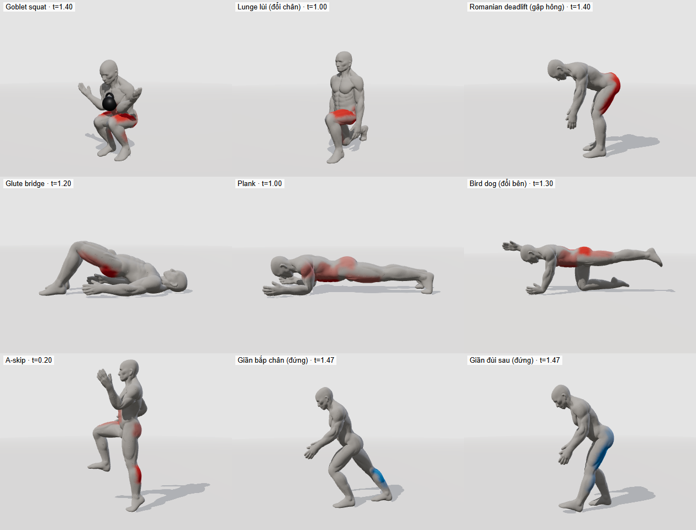
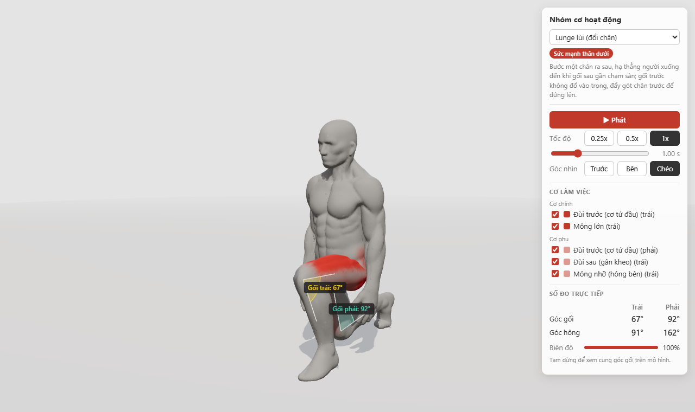

# Exercise Muscles 3D

**Web 3D mô phỏng nhóm cơ hoạt động trong các động tác thể dục**: mô hình người écorché (lộ cơ) thực hiện
động tác, nhóm cơ đang **co** tô đỏ, cơ đang được **kéo giãn** tô xanh, độ đậm theo biên độ
động tác. Kèm số đo góc khớp trực tiếp và gợi ý kỹ thuật cho từng bài.

Thư viện động tác **được thiết kế để mở rộng**: mỗi động tác chỉ là một file dữ liệu khai báo
góc khớp theo thời gian; hệ thống tự dựng animation, tự giữ bàn chân/điểm tựa trên sàn và tự
kiểm tra tư thế (chạm sàn, không xuyên sàn, thăng bằng) trước khi đưa vào sử dụng.



## Tính năng

- **Tô nhóm cơ theo động tác** — cơ chính đậm, cơ phụ nhạt, tách bên trái / phải
  (bài đổi chân đổi màu theo bên đang làm việc). Mô hình không cần UV: vùng cơ được suy ra
  từ khung xương và hình học lúc tải.
- **Menu phân nhóm** — Sức mạnh thân dưới · Core · Khởi động – kỹ thuật chạy · Giãn cơ.
  Mỗi động tác có nhãn *Bài tập / Giãn cơ*, gợi ý kỹ thuật và danh sách cơ chính / phụ.
- **Số đo trực tiếp** — góc gối, góc hông hai chân, biên độ; cung đo góc gối hiện trên mô hình khi tạm dừng.
- **Điều khiển phát** — phát / tạm dừng, tốc độ 0.25x–1x, tua theo thời gian, góc nhìn
  trước / bên / chéo (mỗi bài tự chọn góc nhìn phù hợp). Mặc định mô hình đứng yên, chọn
  động tác mới bắt đầu.
- **Đạo cụ** — bục step-up, tạ ấm goblet squat.



## Chạy dự án

Yêu cầu Node.js 18+ và trình duyệt hỗ trợ WebGL 2.

```bash
npm install
npm run dev       # mở http://localhost:5173
npm run build     # đóng gói vào dist/ (web tĩnh)
npm run check     # tự kiểm tra mọi động tác (Node, không cần trình duyệt)
```

Trình chiếu một khung hình cố định bằng tham số URL, ví dụ
`?ex=plank&t=1&view=side&ui=0` — `ex` động tác, `t` giây, `view` front/side/threeQuarter,
`ui=0` ẩn bảng điều khiển, `force=glutes` tô cố định một nhóm cơ.

## Động tác hiện có

| Nhóm | Động tác |
|---|---|
| Sức mạnh thân dưới | Squat, Goblet squat, Lunge lùi (đổi chân), Romanian deadlift, Step-up lên bục (đổi chân), Glute bridge, Glute bridge 1 chân (đổi chân), Nhón gót gối thẳng / gối cong |
| Core – ổn định thân | Plank, Side plank, Dead bug (đổi bên), Bird dog (đổi bên) |
| Khởi động – kỹ thuật chạy | A-skip, B-skip, Nâng cao đùi, Đá gót |
| Giãn cơ | Giãn cơ gập hông (quỳ 1 gối), Giãn đùi sau, Giãn bắp chân |

Cơ chính / phụ của từng bài hiện trực tiếp trên bảng điều khiển và được khai báo trong file
của bài đó (`src/exercises/`). Các nhóm cơ đang hỗ trợ: đùi trước, gập hông, mông lớn, mông
nhỡ, đùi sau, cơ bụng chân, cơ dép, bụng, chéo bụng, lưng dưới, vai.

## Thêm động tác mới

```js
// src/exercises/rdl.js (rút gọn)
export default {
  id: 'rdl',
  name: 'Romanian deadlift (gập hông)',
  category: 'strength',
  cue: 'Gối hơi chùng, đẩy hông ra sau, lưng thẳng…',
  duration: 3,
  pinnedFoot: 'Both', // hai bàn chân giữ trên sàn
  keyframes: [
    { time: 0, angles: {} }, // tư thế đứng
    { time: 1.4, angles: { Hips: 75, LeftUpLeg: 105, RightUpLeg: 105, LeftLeg: 30, RightLeg: 30 } },
    { time: 3, angles: {} },
  ],
  muscles: { primary: ['hamstrings', 'glutes'], secondary: ['lowerBack'] },
  checks: [{ label: 'Trọng tâm trên bàn chân', at: 'all', com: true, range: [-0.05, 0.15] }],
};
```

Thêm vào `src/exercises/index.js`, chạy `npm run check -- rdl` cho tới khi ĐẠT. Hệ thống hỗ trợ
bài đổi chân (`mirror` / `sequence`), điểm tựa thứ hai cho tư thế nằm/chống (bridge, plank, side
plank), ghim gối hoặc mũi bàn chân, đạo cụ… Quy ước góc, các tuỳ chọn và phép kiểm tra:
**[docs/huong-dan-dong-tac.md](docs/huong-dan-dong-tac.md)**.

## Cấu trúc mã

```
src/main.js          cảnh, camera, ánh sáng, vòng lặp
src/model.js         tải GLB, tư thế đứng (rig), trình phát động tác (cross-fade, biên độ)
src/muscles.js       phân vùng nhóm cơ theo đỉnh + shader tô màu
src/jointAngles.js   công thức đo góc khớp
src/angles.js        bảng số đo + cung góc gối
src/ui.js            bảng điều khiển
src/exercises/       dữ liệu động tác + build.js (góc → animation), compose.js (đổi chân, ghép),
                     check.js (tự kiểm tra), props.js (đạo cụ)
tools/               check-exercise.mjs (npm run check), tune-contacts.mjs (giải góc tiếp xúc)
docs/                hướng dẫn kỹ thuật, ảnh minh hoạ
```

## Công nghệ

[three.js](https://threejs.org/) · [Vite](https://vitejs.dev/) · JavaScript thuần (không framework).
Mô hình: người écorché cao 1,8 m, khung xương Mixamo 41 xương, animation Air Squat
(`public/ecorche_air_squat.glb`).
